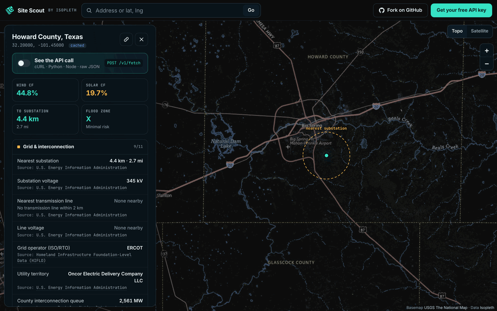
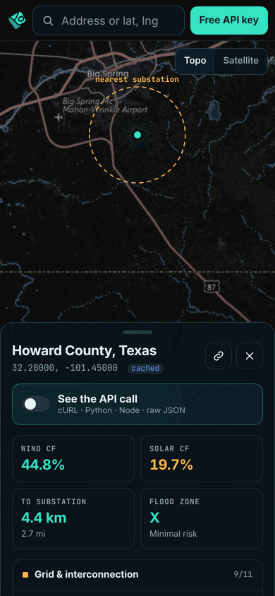
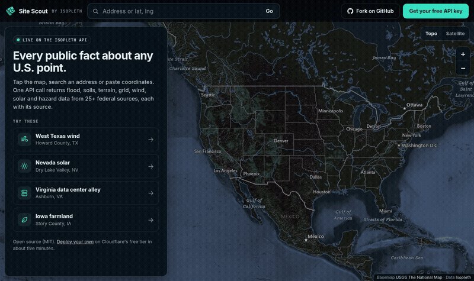

# Site Scout

**Tap any U.S. point. Get the flood zone, soils, terrain, grid distance, wind, solar and hazard facts, each linked to its public source. All from one [Isopleth API](https://isopleth.dev/?utm_source=github&utm_medium=referral&utm_campaign=sitescout) call.**

**Live: [scout.isopleth.dev](https://scout.isopleth.dev)**

[](https://scout.isopleth.dev)

[](https://deploy.workers.cloudflare.com/?url=https://github.com/slurpsyrup/isopleth-site-scout)

Site Scout is a working showcase and a starter you can fork. It is a single Cloudflare Worker with a static front end, and it runs on Cloudflare's free tier. Your API key stays on the server.

- **Three ways in.** Click the map, search an address (free Census geocoding), or paste `lat, lng`.
- **Every value is sourced.** Each fact links to the agency dataset it came from: FEMA, USDA, USGS, NREL, EIA, HIFLD and others.
- **FEMA disaster history from OpenFEMA.** A second card shows the county's federal disaster declarations (count since records began, the last 10 years, the most recent and the most common types) from FEMA's free [OpenFEMA API](https://www.fema.gov/about/reports-and-data/openfema). It needs no key and spends no Isopleth lookups, and it shows how to mix your own public-data calls into the template.
- **See the API call.** One toggle shows the exact request as cURL, Python or Node, plus the raw JSON response, ready to copy.
- **Shareable.** Every point has its own URL, like [`?at=32.20000,-101.45000`](https://scout.isopleth.dev/?at=32.20000,-101.45000&z=11).
- **Mobile first.** A bottom-sheet panel on phones and a side panel on desktop. Lighthouse mobile scores are 90+ in every category.

<p align="center"> &nbsp; </p>

## Deploy your own

You need a free [Cloudflare account](https://dash.cloudflare.com/sign-up) and an Isopleth API key ([get one free](https://isopleth.dev/signup/?utm_source=github&utm_medium=referral&utm_campaign=sitescout)).

### One click

1. Click **Deploy to Cloudflare** above.
2. Sign in to Cloudflare, then connect GitHub so Cloudflare can create your copy of the repo.
3. When it asks for **ISOPLETH_KEY**, paste your Isopleth key. Cloudflare stores it as an encrypted secret.
4. Click **Create and deploy**. Cloudflare creates the KV namespace and rate limiters for you.
5. Open the `*.workers.dev` URL it shows you.

From then on, every push to your repo redeploys automatically.

### Manual

```sh
git clone https://github.com/slurpsyrup/isopleth-site-scout
cd isopleth-site-scout
npm install

# Local development
cp .dev.vars.example .dev.vars      # then put your key in .dev.vars (it is git-ignored)
npm run dev                         # http://localhost:8787

# Deploy
npx wrangler login
npx wrangler secret put ISOPLETH_KEY   # paste your key at the prompt
npm run deploy
```

**Custom domain (optional).** In the Cloudflare dashboard, open **Workers & Pages → isopleth-site-scout → Settings → Domains & Routes → Add → Custom domain**. Or add `"routes": [{ "pattern": "scout.example.com", "custom_domain": true }]` to `wrangler.jsonc`.

## How it works

```
Browser ── static files (index.html, app.js, app.css, Leaflet) ──────────── Workers Static Assets (free, no Worker run)
   │
   ├─ GET /api/point?lat&lng ─┐
   ├─ GET /api/geocode?q ─────┤   Worker (src/worker.js)
                              │   1. Round the point to 5 decimals (~1 m)
                              │   2. Edge cache  (Cache API, per location)  ── hit → done, 0 lookups
                              │   3. KV cache    (global, 7 days)           ── hit → done, 0 lookups
                              │   4. Inside the U.S. envelope?              ── no  → 422, 0 lookups
                              │   5. Per-IP limits + global ceiling         ── over → 429/503, 0 lookups
                              │   6. Census "is this in a state?" check     ── no  → 422, 0 lookups
                              └─► 7. POST https://api.isopleth.dev/v1/fetch   (Authorization: Bearer ISOPLETH_KEY)
                                     1 lookup for up to 50 fields → cached at 2 and 3

   └─ GET /api/disasters?lat&lng   Worker (src/fema.js), no key, no Isopleth lookups
                                   1. Edge cache per point (1 day)  2. Per-IP limit (20 new points a minute)
                                   3. Census geocoder → county FIPS  4. KV cache per county (1 day)
                                   5. GET https://www.fema.gov/api/open/v2/DisasterDeclarationsSummaries
                                      ?$filter=fipsStateCode eq '48' and fipsCountyCode eq '201'  → summarized
```

| Piece | Where | Notes |
| --- | --- | --- |
| Front end | `public/` | Plain ES modules, no framework and no build step. Leaflet 1.9 is vendored in `public/vendor/`. |
| Worker | `src/worker.js`, `src/lib.js`, `src/fema.js` | Has only three read-only routes. The key never reaches the browser. |
| Disaster history | `src/fema.js` | FEMA [OpenFEMA Disaster Declarations Summaries v2](https://www.fema.gov/openfema-data-page/disaster-declarations-summaries-v2), public domain, no key. The card shows the retrieval time and the citation wording FEMA requires in its [terms](https://www.fema.gov/about/openfema/terms-conditions); keep both if you change the card. Counts county-designated declarations; statewide-only ones are not counted. Connecticut is skipped because Census now uses planning regions while OpenFEMA uses the former counties. Remove the route in `src/worker.js` and `loadDisasters` in `public/app.js` if you don't want it. |
| Fields | `public/fields.js` | The single list both the UI and the Worker read. |
| Basemap | [USGS The National Map](https://www.usgs.gov/programs/national-geospatial-program/national-map) | Public-domain topo and imagery tiles. No key needed. |
| Geocoding | Isopleth `/v1/geocode` | Backed by the U.S. Census geocoder. Free, and results are not stored. |
| Limits | `wrangler.jsonc` → `ratelimits` | Defaults: 6 new points a minute and 3 per 10 s per IP, 20 searches a minute per IP, and 15 new points a minute per Cloudflare location overall. The OpenFEMA card allows 20 new points a minute per IP (`DISASTER_LIMITER`). Cache hits are never limited. |
| Analytics | `public/analytics.js` | Cookie-less Umami, counting only on scout.isopleth.dev. It never sends coordinates. **Delete it in your fork** (and its `<script>` tag), or point it at your own site. |

**Cost.** Each new point uses one Isopleth lookup. Repeat visits to the same point, including shared links, are served from cache and cost nothing. On Cloudflare's free plan, static files don't count toward the 100,000 Worker requests a day; only `/api/*` calls do.

## Customize

- **Change the facts.** Edit `public/fields.js`. Add or remove fields (351 are available through the API; see the [field catalog](https://isopleth.dev/docs/?utm_source=github&utm_medium=referral&utm_campaign=sitescout)), rename labels, regroup cards or pick the four headline tiles. Keep it to 50 fields or fewer so each point costs one lookup. `npm test` checks the list against the catalog snapshot in `test/fixtures/meta-fields.json`.
- **Change the presets.** Edit `PRESETS` in `public/fields.js`, then update the pre-rendered buttons in `public/index.html` to match. They are pre-rendered so the panel doesn't jump on load; a test fails if the two drift apart.
- **Partner link (off by default).** `public/partner.js` adds an optional link under the headline facts. On scout.isopleth.dev it is "Buying this land? Get the full buyer's report" on [Check the Land](https://checktheland.com), which opens with the selected point filled in. It only appears when the Worker var `CHECK_THE_LAND_CTA` is `"on"`; the template ships with `"off"`. To point it at your own product, edit `partner.js` and set the var to `"on"`. To remove it entirely, delete `partner.js`, its import in `app.js` and the `#ctl` link in `index.html`.
- **Branding.** Colors are CSS variables at the top of `public/app.css`. The logo is the inline SVG in `index.html`.
- **Limits and caching.** Change `ratelimits` in `wrangler.jsonc` (and `POINT_LIMIT_PER_MIN` to match the message). Bump `CACHE_VERSION` in `src/lib.js` to drop every cached result, or remove the `kv_namespaces` block to use only the edge cache.
- **Basemap.** Swap the tile URLs in `public/app.js`, and add the new tile host to `img-src` in `public/_headers`.

## Develop

```sh
npm run lint     # ESLint
npm test         # node:test unit + Worker tests (fetch, KV and rate limiters are mocked; no key or network needed)
npm run check    # lint + test + wrangler dry-run build
```

CI runs the same checks on every pull request.

## Notes

- The data is for screening, not a survey, title search or flood determination. Always confirm with the source agency.
- Coverage is the 50 states, D.C. and U.S. territories. Points in open ocean or outside the U.S. get a friendly message and cost no lookup.
- The live site at scout.isopleth.dev is deployed as one bundled Worker module, with the same code and an embedded copy of `public/`. Forks should use the standard Static Assets setup in `wrangler.jsonc`, which is what the Deploy button and `npm run deploy` do.

## License

[MIT](LICENSE). Basemap tiles are courtesy of the U.S. Geological Survey. Facts come from the public agencies credited beside each value.
